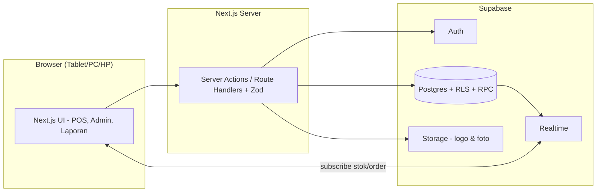
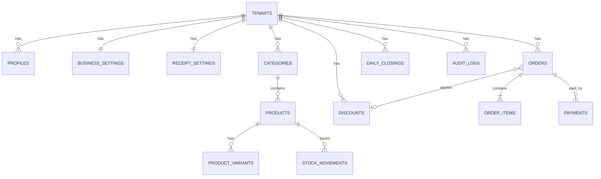
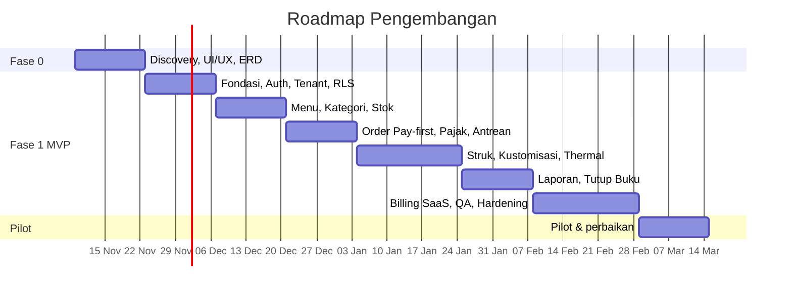

# PRD — **MyPOS**: POS Universal SaaS untuk Cafe

| | |
|---|---|
| Versi | 0.4 (Draft, penambahan paket Basic & Pro) |
| Tanggal | 6 Nov 2026 |
| Referensi | Proposal SiMoca – Sistem Manajemen Order Cafe (Tim 1) |
| Stack | Next.js (full-stack) + Supabase (Postgres, Auth, Storage, Realtime) |
| Status | Menunggu review |

> [!NOTE]
> **Perubahan v0.2:** (1) produk komersial SaaS → modul langganan/billing & batas paket; (2) cetak langsung ke printer thermal masuk MVP; (3) pajak wajib dihitung; (4) **alur pay-first oleh kasir**: konsumen datang ke kasir → kasir mencatat order → konsumen membayar → struk dicetak → pesanan dibuat & diantar (pelayan tidak membuat order); (5) nama produk MyPOS. Lihat [12](#12-asumsi--keputusan).

---

## 1. Ringkasan Eksekutif

**Masalah.** Banyak cafe masih mencatat order, stok, dan rekap kas secara manual. Akibatnya pelayanan lambat, stok tidak sinkron, hitungan diskon salah, dan tutup buku selisih (akar masalah di SiMoca: *cafe belum punya aplikasi manajemen order berbasis POS yang mengintegrasikan stok dan hitungan finansial*).

**Solusi.** Aplikasi web POS **universal, multi-tenant, dan dijual sebagai SaaS berlangganan** yang bisa dipakai cafe mana pun. Fitur inti SiMoca (menu, order, diskon, stok otomatis, struk, rekap harian) dipertahankan. Ditambah **kustomisasi identitas bisnis** (nama, logo, alamat, kontak, footer, pajak/service) dan **kustomisasi template struk** yang tampil di struk, dengan preview langsung.

**Dampak yang diharapkan**
- Waktu pembuatan order + struk turun drastis, tanpa kalkulator.
- Stok akurat otomatis setelah pembayaran.
- Rekap tutup buku akurat 100% secara matematis.
- Satu produk bisa di-onboard banyak cafe tanpa kode tambahan (self-service) dan menghasilkan pendapatan berulang (langganan).
- Struk tercetak langsung di printer thermal tanpa dialog tambahan.

**Perbedaan dari SiMoca:** SiMoca adalah aplikasi Java lokal single-business dengan struk berupa file teks. Produk ini adalah web SaaS multi-tenant dengan database cloud, role-based access, dan struk yang bisa dikustomisasi serta dicetak.

---

## 2. Tujuan & Metrik Keberhasilan

| # | Tujuan | Metrik | Target MVP |
|---|---|---|---|
| G1 | Mempercepat transaksi | Waktu dari item pertama dipilih sampai struk tampil | ≤ 60 detik untuk order 3 item; kalkulasi total ≤ 2 detik (KNF SiMoca) |
| G2 | Akurasi keuangan | Selisih rekap sistem vs. hitung ulang transaksi | 0 selisih (100%) |
| G3 | Akurasi stok | Stok berkurang otomatis saat order dibayar | 100% order lunas memotong stok |
| G4 | Universal & mudah onboarding | Waktu cafe baru dari daftar sampai transaksi pertama | ≤ 15 menit |
| G5 | Branding | Cafe dapat mengubah identitas & template struk tanpa developer | 100% field identitas tampil di struk sesuai pengaturan |
| G6 | Adopsi | Cafe aktif mingguan (pilot) | ≥ 5 cafe pada akhir fase pilot |
| G7 | Komersial | Konversi trial → berbayar | ≥ 25% dari cafe pilot setelah trial 14 hari |
| G9 | Monetisasi | Porsi tenant berbayar yang memilih Pro | ≥ 30% (indikator nilai paket Pro) |
| G8 | Cetak thermal | Keberhasilan cetak langsung pada printer yang didukung | ≥ 98% percobaan cetak |

---

## 3. Analisis Masalah (diadopsi dari SiMoca)

**5 Whys:** Layanan & rekap lambat → pencatatan dan hitung manual → pelayan tak tahu stok terbaru, kasir lama menghitung harga+diskon → tidak ada sistem order yang terintegrasi dengan persediaan → **akar masalah: tidak ada aplikasi POS terpadu.**

**Problem statement.** Pengelolaan order dan rekap keuangan manual berdampak pada kasir, pelayan, dan manajer: layanan lebih lama, ketersediaan produk tidak sesuai, data tutup buku rawan selisih. Solusi berhasil bila sistem memproses order tanpa kalkulator, memperbarui stok otomatis, menerbitkan struk instan, dan menghasilkan rekap harian akurat.

**Masalah tambahan untuk versi universal:** setiap cafe punya identitas, kebijakan pajak/service, dan gaya struk berbeda; satu aplikasi kaku tidak bisa dipakai bersama.

---

## 4. Persona & Jobs-to-be-Done

| Persona | Peran | Job-to-be-done (saat… aku ingin… agar…) | Pain utama |
|---|---|---|---|
| **Kasir (Kiki)** | Input order, bayar, cetak struk | Saat antrean ramai, aku ingin memilih menu cepat dan total otomatis, agar pelanggan tidak menunggu | Hitung manual, nota hilang |
| **Pelayan/Barista (Pandu)** | Menyiapkan & mengantar pesanan yang sudah dibayar, cek ketersediaan | Saat pelanggan bertanya, aku ingin tahu menu/stok tersedia tanpa ke dapur, agar tidak menjanjikan menu habis | Bolak-balik cek stok |
| **Pemilik/Admin (Oma)** | Kelola menu, diskon, laporan, branding | Saat tutup toko, aku ingin laporan kas harian yang rapi, agar cepat tutup buku dan yakin tidak ada selisih; aku ingin struk mencerminkan merek cafe-ku | Rekap manual, struk generik |
| **Super Admin Platform** | Operator produk | Aku ingin memantau tenant & mengelola akun, agar platform sehat | — |

---

## 5. Ruang Lingkup

### 5.1 Dalam cakupan (MVP)
Registrasi cafe (tenant) & onboarding · manajemen user & role · menu & kategori · **order dibuat kasir (pay-first)** · pembayaran oleh kasir (tunai/QRIS manual/transfer dicatat kasir) · **pajak wajib** · diskon · potong stok otomatis & stok real-time · struk (preview, **cetak langsung ke printer thermal**, cetak browser sebagai cadangan, unduh PDF) · **kustomisasi identitas bisnis & template struk** · rekap/tutup buku harian · **antrean penyiapan & pengantaran pesanan** · riwayat transaksi · **paket langganan SaaS (trial, batas paket, status akun)**.

### 5.2 Di luar cakupan (MVP)
- Integrasi payment gateway/e-wallet untuk transaksi pelanggan (pembayaran pelanggan tetap dicatat manual; ditunda ke Fase 2). Catatan: gateway untuk **penagihan langganan** tenant masuk MVP (lihat KF-70+).
- Presensi/penggajian pegawai.
- Integrasi delivery online (GoFood/GrabFood dll.).
- Resep/BOM bahan baku mendalam, multi-cabang konsolidasi, loyalty/member, aplikasi mobile native.

### 5.3 Perbedaan batasan dibanding SiMoca
| SiMoca | Produk ini |
|---|---|
| Java, UI lokal | Next.js web (responsif, PWA-ready) |
| File teks / memori | Supabase Postgres |
| Struk file teks | Struk HTML/PDF dan **cetak langsung thermal ESC/POS** 58/80 mm, bisa dikustomisasi |
| Single business | Multi-tenant (data terisolasi per cafe via RLS) |

---

## 6. Kebutuhan Fungsional

Prioritas: **P0** = wajib MVP, **P1** = penting (Fase 2), **P2** = nice to have. "SiMoca" menandai fitur asal proposal.

### 6.1 Tenant, Auth & Role
| ID | Kebutuhan | Aktor | Prio | Asal |
|---|---|---|---|---|
| KF-01 | Pemilik dapat mendaftarkan cafe baru (tenant) dengan email/password dan wizard onboarding | Pemilik | P0 | Baru |
| KF-02 | Sistem mendukung role **Owner/Admin, Kasir, Pelayan**; hak akses dibatasi per role. Pelayan/barista: melihat antrean pesanan yang sudah dibayar, menandai *diproses/siap/diantar*, dan melihat stok; **tidak** dapat membuat order, membayar, void, diskon, atau melihat laporan | Admin | P0 | SiMoca (SistemUser/UserKasir/UserAdmin) |
| KF-03 | Admin dapat menambah/menonaktifkan akun staf | Admin | P0 | Baru |
| KF-04 | Data tiap cafe terisolasi; user hanya melihat data tenant sendiri | Sistem | P0 | Baru |

### 6.2 Menu, Kategori & Stok
| ID | Kebutuhan | Aktor | Prio | Asal |
|---|---|---|---|---|
| KF-10 | CRUD produk (nama, harga, foto, deskripsi, kategori, status aktif) | Admin | P0 | SiMoca KF-01 |
| KF-11 | CRUD kategori produk (urutan tampil dapat diatur) | Admin | P0 | SiMoca KF-01 |
| KF-12 | Pengaturan stok per produk (jumlah, ambang minimum, opsi "tanpa stok/unlimited") | Admin | P0 | SiMoca KF-05/06 |
| KF-13 | Tampilan stok real-time (Supabase Realtime) untuk semua role; produk habis otomatis ditandai/tidak bisa dipesan | Pelayan, Kasir | P0 | SiMoca KF-06 |
| KF-14 | Penyesuaian stok manual (restock, koreksi) dengan catatan alasan & jejak audit | Admin | P0 | Baru |
| KF-15 | Varian/modifier (ukuran, level gula, tambahan topping) dengan selisih harga | Admin | P1 | Baru |
| KF-16 | Notifikasi stok menipis | Admin | P1 | Baru |
| KF-17 | Impor menu via CSV | Admin | P2 | Baru |

### 6.3 Order & Pembayaran
| ID | Kebutuhan | Aktor | Prio | Asal |
|---|---|---|---|---|
| KF-20 | Membuat order baru dari produk terpilih, mengatur qty, catatan item, nomor meja/nama pelanggan, tipe (dine-in/takeaway) | Kasir | P0 | SiMoca KF-02 |
| KF-28 | **Alur pay-first:** konsumen datang ke kasir → kasir mencatat pesanan dan membuat order → sistem menghitung total (diskon + pajak) → konsumen membayar sesuai total → struk dicetak (otomatis/manual) → pesanan **baru masuk antrean penyiapan setelah lunas**. Struk memuat nomor antrean dan nomor meja/nama untuk pengantaran | Kasir | P0 | Baru |
| KF-29 | **Antrean penyiapan & pengantaran:** order lunas muncul real-time di layar pelayan/barista (tablet/HP) dengan item, catatan, nomor meja/antrean; status *Baru → Diproses → Siap → Diantar/Selesai*; kasir juga melihat statusnya; notifikasi visual/suara untuk order baru; pencatatan waktu tiap tahap | Pelayan/Barista, Kasir | P0 | Baru |
| KF-29a | Cetak **tiket dapur/bar** otomatis setelah lunas (opsional, ke printer kedua) | Sistem | P1 |  Baru |
| KF-21 | Total tagihan dihitung otomatis: subtotal − diskon + **pajak (wajib)** + service charge (opsional), pembulatan sesuai pengaturan. Pajak dihitung pada dasar setelah diskon; mode inklusif/eksklusif dipilih di pengaturan; **tarif pajak wajib diisi saat onboarding dan tidak bisa dinonaktifkan** (hanya diubah tarifnya, dengan jejak audit) | Sistem | P0 | SiMoca KF-03 |
| KF-21a | Struk selalu menampilkan baris pajak (nama pajak, tarif, nominal); laporan harian memisahkan DPP dan pajak | Sistem | P0 | Baru |
| KF-22 | Pembayaran: tunai (hitung kembalian otomatis), QRIS/transfer/kartu (dicatat manual oleh kasir), split bayar sederhana | Kasir | P0 (tunai) / P1 (split) | SiMoca |
| KF-23 | Order berstatus: draft → menunggu bayar → lunas → diproses → siap → diantar/selesai; dibatalkan sebelum bayar tanpa efek stok; void/refund butuh otorisasi Admin | Kasir, Admin | P0 | Baru |
| KF-24 | Stok dipotong **hanya** ketika order terkonfirmasi lunas; dibatalkan = stok dikembalikan; tidak boleh minus | Sistem | P0 | SiMoca KF-05 (enkapsulasi `kurangiStok()`) |
| KF-25 | Simpan/lanjutkan order (hold order) | Kasir | P1 | Baru |
| KF-26 | KDS lanjutan: layar dapur khusus, estimasi waktu, prioritas, statistik | Dapur | P2 | Baru |
| KF-27 | Riwayat transaksi dengan filter tanggal/status/kasir & pencarian nomor order | Admin, Kasir | P0 | Baru |

### 6.4 Diskon & Promo
| ID | Kebutuhan | Aktor | Prio | Asal |
|---|---|---|---|---|
| KF-30 | CRUD aturan diskon: persentase atau nominal, periode aktif, minimal belanja, berlaku untuk produk/kategori/seluruh order | Admin | P0 | SiMoca KF-07 |
| KF-31 | Kasir menerapkan diskon aktif pada order; sistem memvalidasi syarat dan menolak yang tidak sah | Kasir | P0 | SiMoca KF-03 |
| KF-32 | Aturan stacking diskon (satu diskon/order di MVP) | Sistem | P0 | Baru |
| KF-33 | Kode voucher | Admin | P2 | Baru |

### 6.5 Struk & Kustomisasi ⭐ (fitur tambahan utama)
| ID | Kebutuhan | Aktor | Prio |
|---|---|---|---|
| KF-40 | **Profil identitas bisnis**: nama cafe, tagline, logo, alamat, telepon, email, website, media sosial, NPWP (opsional), zona waktu, mata uang | Admin | P0 |
| KF-41 | **Pengaturan struk**: tampilkan/sembunyikan tiap elemen (logo, alamat, kontak, nama kasir, nomor meja, nomor order, tanggal-jam, pajak, service, metode bayar) | Admin | P0 |
| KF-42 | **Teks kustom**: header tambahan, footer (mis. "Terima kasih", wifi password, promo), catatan kaki, dan teks pajak | Admin | P0 |
| KF-43 | **Template struk siap pakai** (mis. Minimal, Klasik, Modern) + pilihan lebar kertas 58 mm / 80 mm + ukuran font, rata teks, pemisah baris | Admin | P0 |
| KF-44 | **Live preview** struk dengan data contoh saat pengaturan diubah | Admin | P0 |
| KF-45 | Logo di struk otomatis diproses menjadi hitam-putih/dithering agar cocok printer thermal | Sistem | P1 |
| KF-46 | QR code/barcode di struk (mis. link Instagram, tautan ulasan, nomor order) | Admin | P1 |
| KF-47 | Format penomoran struk/invoice kustom (prefix, reset harian/bulanan) | Admin | P1 |
| KF-48 | Unduh PDF dan cetak via dialog browser (CSS print) sebagai **cadangan**; kirim via WhatsApp/email (tautan struk digital) | Kasir | P0 (PDF/dialog) / P2 (kirim) |
| KF-52 | **Cetak langsung ke printer thermal (ESC/POS)** tanpa dialog cetak: koneksi via **WebUSB / Web Serial / Web Bluetooth** (Chrome/Edge), perangkat tersimpan per browser, auto-reconnect | Kasir | P0 |
| KF-53 | Pengaturan printer: pilih/uji koneksi, tombol *Test Print*, lebar kertas 58/80 mm, jumlah salinan, auto-cut, buka cash drawer (pulse ESC/POS), indikator status | Admin, Kasir | P0 |
| KF-54 | Struk dirender ke perintah ESC/POS (teks, rata, bold, ukuran, logo bitmap, QR) dari konfigurasi template yang sama dengan preview; antrean cetak dengan retry & pesan galat jelas; jika gagal otomatis tawarkan cetak cadangan | Sistem | P0 |
| KF-55 | **Print agent lokal** untuk printer jaringan (LAN/IP) & iOS tanpa WebUSB; printer dapur terpisah (tiket dapur, KF-29a) | Admin | P1 |
| KF-49 | Cetak ulang struk (ditandai "SALINAN") dan struk digital publik dengan tautan acak | Kasir | P1 |
| KF-50 | Pengaturan bahasa struk (ID/EN) dan format angka/tanggal | Admin | P2 |
| KF-51 | Kustomisasi tema aplikasi (warna aksen, logo di header POS) | Admin | P2 |

### 6.6 Langganan & Billing SaaS (produk komersial)
| ID | Kebutuhan | Aktor | Prio |
|---|---|---|---|
| KF-70 | Dua paket: **Basic** (fitur dasar, batas pemakaian) dan **Pro** (semua fitur, batas longgar/tanpa batas). Definisi paket (harga, batas, fitur) tersimpan di database dan dapat diubah super admin tanpa deploy | Super Admin | P0 |
| KF-78 | **Halaman pilih paket & harga:** perbandingan Basic vs Pro (tabel fitur), toggle bulanan/tahunan, tombol pilih/upgrade; dipakai saat onboarding dan di menu Tagihan | Admin, Publik | P0 |
| KF-79 | **Feature gating:** setiap fitur Pro dikunci berdasarkan `plan.features` di server (Server Action/RLS/RPC), bukan hanya di UI; fitur terkunci tampil dengan label *Pro* + ajakan upgrade | Sistem | P0 |
| KF-80 | **Upgrade/downgrade:** upgrade Basic→Pro langsung aktif dengan prorata; downgrade berlaku di akhir periode; saat turun ke Basic data tidak dihapus — fitur/entitas melebihi batas menjadi hanya-baca sampai disesuaikan | Admin | P0 |
| KF-71 | **Trial 14 hari** otomatis saat registrasi; status tenant: trial, aktif, tunggakan (grace 7 hari), ditangguhkan | Sistem | P0 |
| KF-72 | Pembatasan sesuai paket (blokir melebihi batas, ajakan upgrade); tenant ditangguhkan tetap aman & dapat mengekspor data | Sistem | P0 |
| KF-73 | Penagihan berulang bulanan/tahunan via Midtrans/Xendit: invoice, VA/QRIS/e-wallet, webhook, perpanjangan otomatis | Admin | P0 (sebelum trial pertama berakhir) |
| KF-74 | Halaman tagihan: riwayat invoice, ganti paket, unduh faktur | Admin | P0 |
| KF-75 | Dashboard super admin: daftar tenant, MRR, churn, suspend/aktifkan, impersonasi dengan jejak audit | Super Admin | P0 (dasar) / P1 (lengkap) |
| KF-76 | Landing page + pricing + pendaftaran, syarat layanan & kebijakan privasi | Publik | P1 |
| KF-77 | Email transaksional (verifikasi, invoice, trial berakhir, tunggakan) | Sistem | P0 |

#### Matriks Paket Basic vs Pro

| Area | Fitur | Basic | Pro |
|---|---|:-:|:-:|
| Batas | Outlet | 1 | 1 (multi-outlet Fase 3) |
| | Pengguna (admin/kasir/pelayan) | maks 3 | maks 15 |
| | Produk aktif | maks 50 | tanpa batas |
| | Riwayat transaksi dapat dilihat | 90 hari | tanpa batas |
| Menu & stok | CRUD produk, kategori, foto | ✅ | ✅ |
| | Stok real-time & potong otomatis | ✅ | ✅ |
| | Varian/modifier (ukuran, gula, topping) | ❌ | ✅ |
| | Notifikasi stok menipis, impor CSV | ❌ | ✅ |
| Order & bayar | Order kasir pay-first, pajak wajib, tunai & pencatatan manual QRIS/transfer | ✅ | ✅ |
| | Antrean penyiapan & pengantaran | ✅ | ✅ |
| | Diskon | 1 diskon aktif, persentase/nominal | Tanpa batas, per produk/kategori, minimal belanja, voucher |
| | Hold order, split bayar | ❌ | ✅ |
| Struk | Identitas bisnis (nama, logo, alamat, telepon, footer) | ✅ | ✅ |
| | Template struk | 1 (Minimal) | Semua template |
| | Kustomisasi lanjut (toggle elemen, header, QR, nomor kustom, logo thermal, bahasa) | ❌ | ✅ |
| | Cetak langsung thermal (USB/Serial/Bluetooth), PDF, cetak cadangan | ✅ | ✅ |
| | Print agent LAN/iOS, multi-printer, tiket dapur | ❌ | ✅ |
| | Struk digital (tautan/WhatsApp/email) | ❌ | ✅ |
| Laporan | Laporan harian & tutup buku | ✅ | ✅ |
| | Laporan lanjutan (produk terlaris, tren, stok, per kasir/waktu penyiapan), dashboard | ❌ | ✅ |
| | Ekspor PDF/CSV | ❌ | ✅ |
| Keamanan & dukungan | Audit log | Dasar (void/refund) | Lengkap |
| | Dukungan | Email/komunitas | Prioritas (chat) |

> [!NOTE]
> Prinsip pembagian: semua yang dibutuhkan untuk **menjalankan transaksi harian hingga struk tercetak** ada di Basic (termasuk cetak thermal & pajak, agar produk tetap berguna dan tidak melanggar kewajiban pajak). Pro menambah **kustomisasi, otomasi, skala, dan analitik**. Pembagian ini usulan awal dan dapat diubah lewat data `plans.features`.

**Harga (usulan awal, perlu divalidasi):**

| | Basic | Pro |
|---|---|---|
| Bulanan | Rp 99.000 | Rp 249.000 |
| Tahunan | Rp 990.000 (hemat 2 bulan) | Rp 2.490.000 (hemat 2 bulan) |
| Trial | 14 hari **akses penuh Pro**, lalu pilih paket | |

### 6.7 Laporan & Tutup Buku
| ID | Kebutuhan | Aktor | Prio | Asal |
|---|---|---|---|---|
| KF-60 | Laporan kas harian dari seluruh order berstatus selesai/lunas: total penjualan, diskon, **pajak (DPP & PPN terpisah)**, service, per metode bayar, jumlah transaksi, per kasir, rata-rata waktu penyiapan | Admin | P0 | SiMoca KF-08 |
| KF-61 | Tutup shift/tutup buku: input kas fisik, sistem menampilkan selisih, hasil dikunci & tidak bisa diubah | Admin/Kasir | P0 | SiMoca (tutup buku) |
| KF-62 | Ekspor laporan ke PDF/CSV | Admin | P1 | Baru |
| KF-63 | Laporan produk terlaris, tren penjualan harian/mingguan/bulanan | Admin | P1 | Baru (analisis tren, sesuai latar belakang SiMoca) |
| KF-64 | Laporan stok & pergerakan stok | Admin | P1 | Baru |
| KF-65 | Dashboard ringkasan hari ini | Admin | P1 | Baru |

---

## 7. Kebutuhan Nonfungsional

| ID | Kategori | Kebutuhan terukur |
|---|---|---|
| KNF-01 | Kinerja | Kalkulasi total + diskon ≤ 2 detik (SiMoca); LCP halaman POS ≤ 2,5 dtk pada 4G; operasi tulis order p95 ≤ 800 ms |
| KNF-02 | Keamanan | Autentikasi Supabase Auth; **Row Level Security** pada semua tabel berbasis `tenant_id`; role dicek di server (Route Handler/Server Action) dan RLS; password hashing & rate limiting login; HTTPS wajib |
| KNF-03 | Keandalan finansial | Perhitungan uang memakai integer (rupiah, tanpa float) atau `numeric`; total dihitung di server, bukan percaya klien; transaksi database atomik (order + pembayaran + potong stok dalam satu transaksi/RPC) |
| KNF-04 | Integritas data | Stok tidak boleh negatif (constraint `CHECK`); laporan tutup buku immutable; audit log untuk void, refund, ubah harga, koreksi stok |
| KNF-05 | Ketersediaan | Target uptime ≥ 99,5%; backup harian otomatis (Supabase), RPO ≤ 24 jam |
| KNF-06 | Offline resilience | MVP: tampilkan pesan koneksi terputus dan cegah kehilangan keranjang (state lokal). Fase 2: PWA dengan antrean order offline & sinkronisasi |
| KNF-07 | Kegunaan | UI touch-friendly (target sentuh ≥ 44 px), tablet-first & responsif, kasir dapat membuat order tanpa pelatihan > 30 menit; aksesibilitas WCAG 2.1 AA untuk kontras dan fokus keyboard |
| KNF-08 | Skalabilitas | 1.000 tenant, 500 order/hari/tenant tanpa perubahan arsitektur; indeks pada `(tenant_id, created_at)` |
| KNF-09 | Kompatibilitas | Chrome/Edge 2 versi terakhir (Android & desktop) untuk cetak langsung thermal; Safari/iOS didukung untuk aplikasi + cetak cadangan (cetak langsung via print agent, KF-55). Printer ESC/POS 58/80 mm generik (mis. Epson TM, Xprinter, RPP02); daftar printer teruji dipublikasikan |
| KNF-13 | Cetak | Tombol cetak sampai struk keluar ≤ 3 detik; koneksi printer pulih otomatis; order tidak hilang bila printer gagal |
| KNF-14 | Real-time | Order lunas muncul di layar pelayan/barista ≤ 3 detik; perubahan status terlihat di kasir ≤ 3 detik |
| KNF-15 | SaaS | Isolasi tenant, ekspor data, SLA publik, penagihan idempoten via webhook bertanda tangan |
| KNF-10 | Kepatuhan | Zona waktu per tenant (default Asia/Jakarta); mengikuti UU PDP untuk data pelanggan minimal; **pajak wajib** pada setiap transaksi dengan tarif per tenant (default 10%, dapat disesuaikan, mis. PB1 daerah), dirinci pada struk dan laporan |
| KNF-11 | Observabilitas | Error tracking (mis. Sentry), log server, metrik dasar |
| KNF-12 | Maintainability | TypeScript strict, lint + format, test unit logika harga/diskon/stok (cakupan ≥ 90% modul tersebut), CI di setiap PR |

---

## 8. User Stories & Acceptance Criteria (ringkas, format Given-When-Then)

**US-01 (Kasir) – Buat order & hitung otomatis**
*Sebagai kasir, saya ingin memilih menu dan melihat total otomatis, agar tidak perlu kalkulator.*
- Given keranjang berisi Latte 2× Rp28.000 dan Croissant 1× Rp22.000, When diskon 10% aktif diterapkan dan pajak 10% diatur, Then subtotal Rp78.000, diskon Rp7.800, pajak sesuai pengaturan, total tampil ≤ 2 detik.
- Given produk stok 0, When kasir memilih produk, Then ditolak dengan pesan stok habis.

**US-02 (Kasir) – Pembayaran tunai & struk**
- Given total Rp70.200, When kasir input uang Rp100.000, Then kembalian Rp29.800 dan order berstatus lunas.
- Given order lunas dan printer thermal terhubung, When kasir menekan Cetak (atau otomatis setelah bayar), Then struk keluar langsung tanpa dialog sesuai template/identitas cafe; bila printer terputus muncul pesan jelas dan opsi cetak cadangan/ulang.

**US-03 (Sistem) – Potong stok atomik**
- Given order lunas, Then stok tiap item berkurang sebanyak qty dalam transaksi yang sama; jika salah satu gagal, seluruh transaksi di-rollback.
- Given order dibatalkan/void setelah lunas, Then stok dikembalikan dan tercatat di audit log.

**US-04a (Kasir) – Alur pay-first**
- Given konsumen memesan 2 Latte di kasir, When kasir membuat order, memilih bayar, dan pembayaran dikonfirmasi, Then struk tercetak dengan nomor antrean dan order masuk antrean penyiapan; order yang belum lunas **tidak** muncul di layar penyiapan.

**US-04b (Pelayan) – Siapkan & antar pesanan**
- Given order lunas nomor A-012 meja 4, When pelayan membuka antrean di HP, Then order muncul ≤ 3 detik; pelayan menandai Diproses → Siap → Diantar, dan kasir melihat status terbaru. Pelayan tidak melihat tombol buat order/bayar/diskon/void.

**US-04 (Pelayan) – Cek ketersediaan**
- Given stok berubah dari perangkat kasir, When pelayan membuka daftar menu, Then stok terbarui otomatis ≤ 3 detik tanpa refresh manual.

**US-05 (Admin) – Kelola menu & diskon**
- Given admin login, When menambah produk/kategori/diskon, Then data tersimpan dan langsung tersedia di POS; kasir/pelayan tidak dapat mengakses halaman ini (403).

**US-06 (Admin) – Kustomisasi identitas bisnis**
- Given admin mengisi nama "Kopi Senja", unggah logo, alamat, dan footer "Wifi: senja123", When menyimpan, Then preview langsung menampilkan semua elemen dan struk berikutnya memakai data itu; struk lama tidak berubah (snapshot).

**US-07 (Admin) – Kustomisasi template struk**
- Given admin memilih template "Minimal", kertas 58 mm, dan menyembunyikan nama kasir, When melihat preview, Then tata letak mengikuti pilihan; **reset ke default** tersedia.

**US-08 (Admin) – Tutup buku harian**
- Given 40 order lunas hari ini, When admin membuka Tutup Buku, Then sistem menampilkan total kas per metode; setelah kas fisik dimasukkan, selisih dihitung dan laporan dikunci.

**US-09 (Pemilik cafe baru) – Onboarding mandiri**
- Given akun baru, When menyelesaikan wizard (identitas → kategori awal → menu pertama → template struk), Then dapat melakukan transaksi pertama ≤ 15 menit.

**US-11 (Admin) – Pajak wajib**
- Given tenant baru, When onboarding, Then tarif pajak wajib diisi sebelum bisa bertransaksi; struk & laporan selalu menampilkan pajak.

**US-13 (Pemilik) – Pilih paket**
- Given trial berjalan, When pemilik membuka halaman Paket, Then ia melihat perbandingan Basic vs Pro dan harga; memilih Basic membatasi fitur sesuai matriks, memilih Pro membuka semua fitur.
- Given tenant Basic, When mencoba membuat produk ke-51 atau membuka template Pro, Then ditolak oleh server dengan pesan upgrade (bukan sekadar disembunyikan di UI).
- Given upgrade ke Pro, Then fitur aktif seketika dan tagihan prorata dihitung; Given downgrade ke Basic, Then berlaku di akhir periode dan data tetap utuh (hanya-baca bila melebihi batas).

**US-12 (Pemilik) – Langganan**
- Given trial 14 hari berakhir tanpa pembayaran, Then tenant masuk grace period 7 hari dengan peringatan, lalu ditangguhkan (hanya baca/ekspor).

**US-10 (Admin) – Kontrol akses**
- Given staf role kasir, When mengakses laporan keuangan, Then ditolak di UI dan di API/RLS.

---

## 9. Arsitektur & Spesifikasi Teknis

### 9.1 Stack
| Lapisan | Teknologi |
|---|---|
| Framework | **Next.js (App Router)**, React, TypeScript strict |
| UI | Tailwind CSS + shadcn/ui |
| Server logic | Server Actions / Route Handlers (validasi **Zod**) |
| Database | **Supabase Postgres** (RLS, RPC/functions untuk transaksi atomik) |
| Auth | Supabase Auth (`@supabase/ssr`), custom claims `tenant_id` & `role` |
| Realtime | Supabase Realtime (stok, status order) |
| Storage | Supabase Storage (logo, foto produk; bucket per tenant) |
| State/Data | TanStack Query, Zustand (keranjang POS) |
| Cetak thermal | Encoder **ESC/POS** (mis. `esc-pos-encoder`) + **WebUSB/Web Serial/Web Bluetooth**; antrean cetak; print agent lokal (P1) |
| Cetak/PDF | CSS `@media print` (cadangan); PDF via `@react-pdf/renderer` |
| Feature gating | Tabel `plans.features/limits` + helper `can(feature)` dan `withinLimit(resource)` dipakai di Server Actions, RPC, dan RLS |
| Billing | Midtrans/Xendit (recurring + webhook), Resend/Postmark untuk email |
| Testing | Vitest (unit), Playwright (E2E), pgTAP/uji RLS |
| Hosting/CI | Vercel + GitHub Actions; Supabase project terpisah dev/staging/prod |
| Monitoring | Sentry, Vercel Analytics |

### 9.2 Diagram arsitektur



### 9.3 Model data (ERD)



| Tabel | Kolom penting |
|---|---|
| `tenants` | id, name, slug, plan, created_at |
| `profiles` | id (=auth.users.id), tenant_id, role (`admin`/`cashier`/`waiter`), full_name, is_active |
| `business_settings` | tenant_id, business_name, tagline, logo_path, address, phone, email, website, socials (jsonb), tax_id, timezone, currency, tax_name, tax_rate (**NOT NULL, > 0**), service_rate, tax_inclusive, rounding_rule |
| `receipt_settings` | tenant_id, template (`minimal`/`classic`/`modern`), paper_width (58/80), font_size, align, show_* flags (jsonb), header_text, footer_text, qr_content, number_prefix, language |
| `categories` | id, tenant_id, name, sort_order |
| `products` | id, tenant_id, category_id, name, price (int), image_path, track_stock, stock (int CHECK ≥ 0), min_stock, is_active |
| `product_variants` | id, product_id, name, price_delta |
| `discounts` | id, tenant_id, name, type (`percent`/`amount`), value, scope, min_purchase, starts_at, ends_at, is_active |
| `orders` | id, tenant_id, order_no, status, type, table_no, customer_name, subtotal, discount_total, tax_total, service_total, grand_total, cashier_id, prepared_by, delivered_by, queue_no, prep_status (`new`/`preparing`/`ready`/`delivered`), prep_started_at, ready_at, delivered_at, discount_id, **receipt_snapshot (jsonb)**, created_at, paid_at |
| `order_items` | id, order_id, product_id, name_snapshot, price_snapshot, qty, notes |
| `payments` | id, order_id, method, amount, change, reference |
| `stock_movements` | id, product_id, delta, reason, ref_order_id, created_by |
| `plans` | id, code (`basic`/`pro`), name, price_monthly, price_yearly, limits (jsonb: max_users, max_products, history_days), features (jsonb: flag per fitur Pro), is_active |
| `subscriptions` | tenant_id, plan_id, status (`trial`/`active`/`past_due`/`suspended`), trial_ends_at, current_period_end, gateway_ref |
| `invoices` | id, tenant_id, amount, status, period, gateway_ref, paid_at |
| `printers` | id, tenant_id, name, connection (`usb`/`serial`/`bluetooth`/`agent`), paper_width, auto_cut, open_drawer, copies |
| `daily_closings` | id, tenant_id, date, expected_cash, actual_cash, difference, totals (jsonb), closed_by, locked_at |
| `audit_logs` | id, tenant_id, actor_id, action, entity, entity_id, payload, created_at |

> [!IMPORTANT]
> `orders.receipt_snapshot` menyimpan identitas bisnis + pengaturan struk pada saat transaksi, sehingga struk lama tetap sama walau identitas diubah kemudian.

### 9.4 Aturan kritis
1. Fungsi Postgres `pay_order(order_id, payments)` melakukan: validasi total → insert pembayaran → ubah status → potong stok → catat `stock_movements` → isi snapshot, **dalam satu transaksi** (menggantikan `kurangiStok()` SiMoca).
2. RLS contoh: `tenant_id = (auth.jwt() ->> 'tenant_id')::uuid`; operasi sensitif juga mengecek `role`.
3. Rumus: `grand_total = subtotal − discount + tax + service` (+ pembulatan); implementasi tunggal di modul `lib/pricing` yang dipakai server dan UI, diuji dengan table-driven test.
4. Aturan role (adopsi pewarisan/polimorfisme SiMoca ke RBAC): satu sumber kebenaran izin per role, UI menampilkan menu sesuai role.

### 9.5 Struktur rute (App Router, ringkas)
```
/(auth)/login, /register, /onboarding
/(app)/pos            # layar kasir
/(app)/orders         # riwayat & detail
/(app)/menu           # produk, kategori, stok
/(app)/discounts
/(app)/reports        # harian, tutup buku, produk
/(app)/settings/business   # identitas bisnis
/(app)/settings/receipt    # template struk + preview
/(app)/settings/printer    # koneksi & uji printer thermal
/(app)/prep                # antrean penyiapan & pengantaran (pelayan/barista)
/(app)/billing             # paket & tagihan
/(admin)/tenants           # super admin
/(app)/settings/staff
/r/[token]            # struk digital publik
```

### 9.6 Sketsa tata letak struk (default "Minimal", 58 mm)
```
        [LOGO]
      KOPI SENJA
  "Ngopi sampai senja"
 Jl. Melati No.5, Surabaya
      0812-xxxx-xxxx
--------------------------
No: INV-20261106-0042
Tgl: 06/11/2026 20:15
Kasir: Kiki   Meja: 4
--------------------------
Latte         2 x 28.000
                    56.000
Croissant     1 x 22.000
                    22.000
--------------------------
Subtotal            78.000
Diskon 10%          -7.800
PPN 10%              7.020
TOTAL               77.220
Tunai              100.000
Kembali             22.780
--------------------------
 Wifi: senja123
 Terima kasih!
 [QR IG @kopisenja]
```

---

## 10. Rencana Pengembangan

Asumsi tim kecil (2–4 developer + 1 QA/dokumentasi). Sprint 2 minggu. Estimasi durasi MVP ±16 minggu + 2 minggu pilot (bertambah dari 12 karena cetak thermal langsung, alur pay-first & antrean penyiapan, dan billing SaaS).



| Fase | Durasi | Luaran utama | Cakupan (ID) |
|---|---|---|---|
| **0. Discovery & Desain** | Minggu 1–2 | Wireframe/UI kit, ERD final, kontrak API, validasi dengan 3–5 cafe | — |
| **1.1 Fondasi** | Minggu 3–4 | Repo, CI/CD, Supabase dev/staging, auth, tenant & role, RLS + uji RLS, onboarding awal | KF-01–04 |
| **1.2 Katalog & Stok** | Minggu 5–6 | CRUD produk/kategori, stok, realtime, audit log stok | KF-10–14 |
| **1.3 Transaksi & Antrean Penyiapan** | Minggu 7–8 | Layar POS kasir (pay-first), layar antrean penyiapan/pengantaran real-time, pajak wajib, diskon, pembayaran tunai, RPC `pay_order`, void | KF-20–24, 27–29, 30–32, 21a |
| **1.4 Struk, Branding & Thermal** ⭐ | Minggu 9–11 | Identitas bisnis, pengaturan struk, 3 template, live preview, encoder ESC/POS, koneksi WebUSB/Serial/Bluetooth, test print, cash drawer, PDF cadangan, snapshot | KF-40–44, 48, 52–54 |
| **1.5 Laporan** | Minggu 12–13 | Laporan harian (DPP/pajak), tutup buku, riwayat | KF-60–61 |
| **1.6 Billing SaaS & Stabilisasi** | Minggu 14–16 | Dua paket Basic/Pro, halaman pilih paket, feature gating server-side, upgrade/downgrade, trial, penagihan Midtrans/Xendit, halaman billing, super admin dasar, email, E2E, uji printer di perangkat nyata, dokumentasi | KF-70–75, 77–80 |
| **Rilis MVP / Pilot** | Minggu 17–18 | Pilot 3–5 cafe, uji merek printer, umpan balik, hotfix | G6–G8 |
| **2. Peningkatan** | Setelah MVP | Varian/modifier, hold order, split bayar, laporan lanjutan, QR/logo thermal, nomor kustom, PWA offline, voucher | KF-15, 16, 22, 25, 45–47, 49, 55, 62–65, 33, 76 |
| **3. Ekspansi** | Roadmap | Payment gateway/QRIS dinamis, multi-cabang, KDS, loyalty, kirim struk WhatsApp, langganan/billing | KF-26, 50, 51 dll. |

### Pembagian peran (usulan)
| Peran | Tanggung jawab |
|---|---|
| Product/Project Manager | Backlog, prioritas, koordinasi pilot |
| Full-stack dev (×2) | Next.js, Server Actions, Supabase schema/RPC/RLS, ESC/POS & billing |
| UI/UX (bisa dirangkap) | Desain POS & editor struk |
| QA & Dokumentasi | Test plan, E2E, panduan pengguna |

### Definition of Done
Kode lolos lint/type-check/test di CI · acceptance criteria terpenuhi · RLS teruji untuk tabel baru · tidak ada float untuk uang · terdokumentasi · demo di staging.

### Strategi pengujian
- **Unit:** pricing, diskon, pembulatan, stok (table-driven).
- **Integrasi:** RPC `pay_order`, rollback, konkurensi dua kasir membeli stok terakhir.
- **Keamanan:** uji isolasi tenant & role (pgTAP + Playwright).
- **E2E:** alur order → bayar → struk → tutup buku.
- **UAT:** skenario nyata di cafe pilot.

---

## 11. Risiko & Mitigasi

| Risiko | Dampak | Mitigasi |
|---|---|---|
| Kebocoran data antar tenant | Kritis | RLS wajib + uji otomatis, tinjau kebijakan per migrasi |
| Dua kasir menjual stok terakhir bersamaan | Tinggi | Update stok atomik dengan `UPDATE ... WHERE stock >= qty` di RPC |
| Internet cafe tidak stabil | Tinggi | Fase 2 PWA offline; MVP simpan keranjang lokal & retry aman (idempotency key) |
| Cetak langsung thermal tidak jalan di iOS/Safari & beragam merek printer | **Tinggi** | Daftar perangkat teruji, Chrome/Android/desktop jadi target resmi, cadangan cetak browser, print agent (P1), uji ≥ 4 model printer sebelum pilot |
| Struk tidak pas di berbagai printer thermal | Sedang | Lebar 58/80 mm, codepage ESC/POS, opsi font/margin, Test Print |
| Pesanan lunas terlewat/tertukar saat ramai | Sedang | Antrean real-time dengan nomor antrean di struk & layar, notifikasi order baru, status per tahap, tiket dapur (P1) |
| Fitur Pro bocor ke Basic (gating hanya di UI) | Sedang | Gating wajib di server/RLS/RPC, uji otomatis per fitur & per batas, satu helper `can(feature)` |
| Basic terlalu sempit/terlalu longgar sehingga konversi rendah | Sedang | Batas & fitur dikonfigurasi di data, A/B harga, pantau konversi trial→paket (G7) |
| Kegagalan penagihan/webhook langganan | Sedang | Idempotensi, grace period, rekonsiliasi harian, notifikasi email |
| Salah hitung pajak (inklusif/eksklusif, pembulatan) | Tinggi | Modul pricing tunggal, test table-driven, konfirmasi aturan dengan akuntan pilot |
| Selisih perhitungan uang | Tinggi | Integer rupiah, satu modul pricing, test table-driven |
| Cakupan melebar (fitur kustomisasi tak terbatas) | Sedang | Batasi ke template + toggle + teks; editor drag-and-drop ditunda |
| Kepatuhan pajak berbeda tiap usaha | Sedang | Tarif & mode (inklusif/eksklusif) dapat diatur, bukan hard-code |
| Adopsi rendah | Sedang | Onboarding ≤ 15 menit, impor CSV (Fase 2), pilot dekat |

---

## 12. Asumsi & Keputusan

**Keputusan (dari klarifikasi)**
1. Produk **komersial SaaS** berlangganan.
2. **Cetak langsung ke printer thermal** wajib di MVP.
3. **Pajak wajib** dihitung pada setiap transaksi.
4. **Alur pay-first oleh kasir:** konsumen datang ke kasir → kasir mencatat & membuat order → konsumen membayar sesuai total sistem → struk dicetak → pesanan dibuat dan diantar pelayan. Pelayan tidak membuat order.
5. Nama produk: **MyPOS**.
6. Asumsi tim 2–4 developer dinyatakan sesuai; jadwal menjadi ±16 minggu + pilot karena cakupan bertambah.

**Asumsi**
1. Mata uang IDR, UI Bahasa Indonesia (struktur i18n siap).
2. Pembayaran pelanggan non-tunai dicatat manual kasir.
3. Satu tenant = satu outlet di MVP.
4. Cetak langsung: Chrome/Edge (Android & desktop) via WebUSB/Web Serial/Web Bluetooth; iOS lewat print agent (Fase 2).
5. Penagihan langganan via Midtrans atau Xendit (dipilih di Fase 1.6). **Dua paket: Basic & Pro**; harga Rp 99.000 / Rp 249.000 per bulan hanyalah usulan awal; trial 14 hari dengan akses Pro penuh.
6. Tarif pajak default 10%, dapat disesuaikan per tenant.

**Pertanyaan terbuka (tidak menghambat mulai)**
0. Apakah ada pemesanan dibayar belakangan (pay-later/dine-in tab)? Saat ini diasumsikan **tidak** (pay-first saja).
1. Konfirmasi harga dan batas paket (pengguna, produk, riwayat) serta pembagian fitur Basic/Pro di matriks.
2. Merek/koneksi printer thermal yang paling umum di target pelanggan (USB vs Bluetooth)?
3. Tiket dapur di printer terpisah ditetapkan **Fase 2 (KF-29a)** kecuali Anda ingin di MVP.

---

## 13. Traceability SiMoca → PRD

| SiMoca | Padanan di PRD | Catatan |
|---|---|---|
| KF-01 CRUD produk & kategori | KF-10, KF-11 | Ditambah foto, urutan, status |
| KF-02 Buat order | KF-20 | Ditambah tipe order, meja |
| KF-03 Total + diskon otomatis | KF-21, KF-31 | Ditambah pajak/service |
| KF-04 Struk | KF-40–49 | **Diperluas: identitas & template kustom** |
| KF-05 Potong stok | KF-24 | Atomik via RPC |
| KF-06 Stok real-time | KF-13 | Supabase Realtime |
| KF-07 Kelola diskon | KF-30 | Periode, syarat minimal |
| KF-08 Laporan harian | KF-60, KF-61 | Ditambah tutup kas & kunci |
| KNF-01 ≤ 2 detik | KNF-01 | Dipertahankan |
| KNF-02 Akses Admin | KNF-02, KF-02 | RBAC + RLS |
| Kelas Order/Produk/Transaksi/Diskon/LaporanHarian | `orders`, `products`, `payments`, `discounts`, `daily_closings` | Pemetaan OOP → relasional |
| SistemUser → UserKasir/UserAdmin | `profiles.role` | RBAC |
