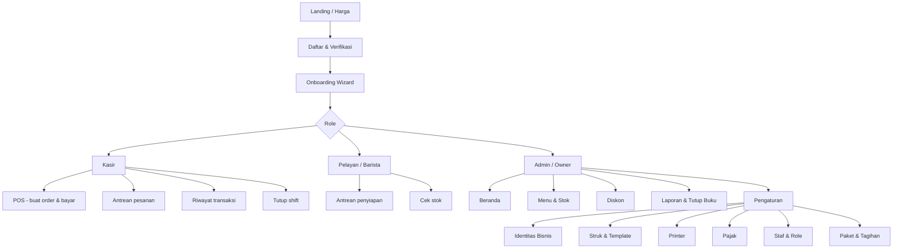
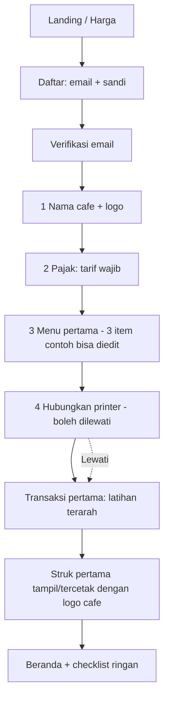
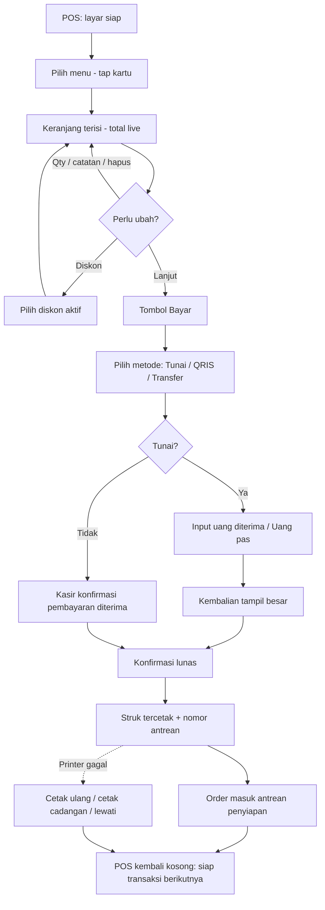
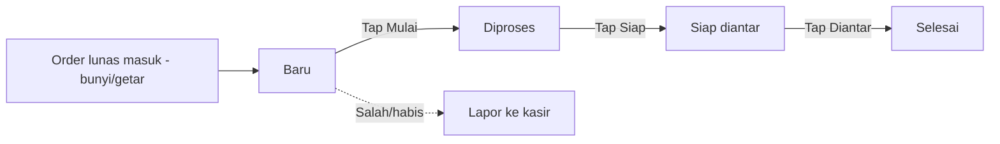
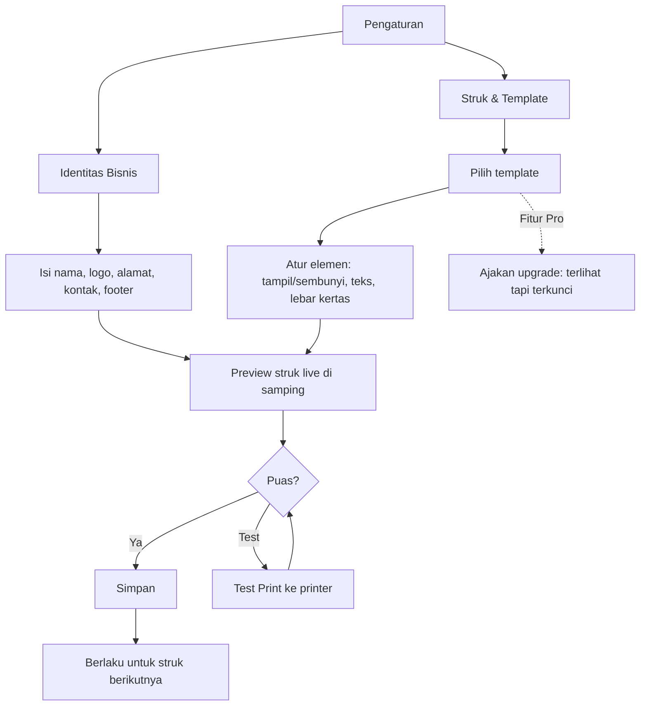
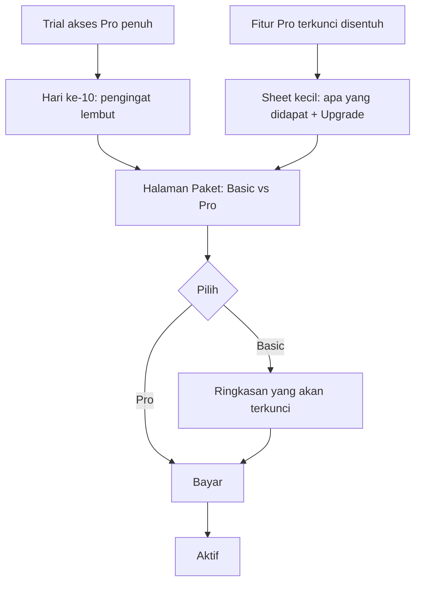
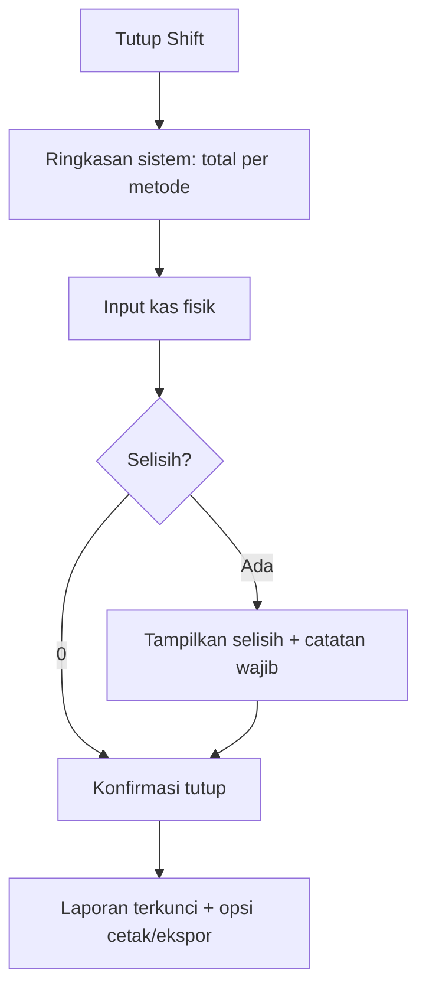

# MyPOS — Perencanaan Alur & Fondasi UX

| | |
|---|---|
| Versi | 0.1 (Draft) |
| Acuan | [PRD v0.4](file:///mnt/MazedevUbuntu/projects/pos/docs/PRD.md) |
| Skill yang dipakai | `ux-flow` (alur & navigasi), `ux-feedback` (state), `ux-copy` (microcopy), `onboarding-psychologist` (onboarding) |
| Cakupan | Perencanaan alur dan fondasi. Belum wireframe/hi-fi dan belum kode halaman |

> [!NOTE]
> Skill `ux-flow`/`ux-copy`/`ux-feedback` berasal dari design system StyleSeed (bergaya mobile, `PageShell/TopBar/BottomNav`). Aturan umumnya saya pakai (progressive disclosure, maks 3 tap, 4 state per area data, tombol berupa kata kerja), tetapi disesuaikan untuk POS **tablet-first** dan **Bahasa Indonesia**. Folder komponen StyleSeed tidak ada di proyek ini, jadi tidak ada halaman yang digenerate.

---

## 1. Prinsip UX Inti

| # | Prinsip | Penerapan di MyPOS |
|---|---|---|
| P1 | **Kecepatan kasir di atas segalanya** | Alur utama (pilih menu → bayar → struk) harus muat di **satu layar tanpa pindah halaman**; tidak ada konfirmasi yang tidak perlu |
| P2 | **Satu layar, satu pertanyaan utama** | POS: "Apa yang dipesan?" · Bayar: "Berapa yang diterima?" · Antrean: "Apa yang harus dibuat sekarang?" |
| P3 | **Progressive disclosure** | Fitur lanjutan (varian, diskon, split bayar) tersembunyi di balik satu tap, tidak menumpuk di layar utama |
| P4 | **Hick & Miller** | Maks 5–9 kelompok per layar; kategori menu sebagai tab/chip; jumlah aksi per layar dibatasi |
| P5 | **Role-aware** | Tiap role hanya melihat menu miliknya (kasir, pelayan, admin); tidak ada tombol yang membuat salah |
| P6 | **Kepercayaan pada uang** | Total, pajak, kembalian selalu tampil jelas, bernada tenang; aksi berisiko (void, tutup buku) butuh konfirmasi |
| P7 | **Tahan gangguan** | Koneksi putus, printer mati, kertas habis: keranjang aman, ada jalur pemulihan |
| P8 | **Ramah untuk pemula** | Pemilik cafe bukan orang teknis; istilah sederhana, onboarding ≤ 15 menit |
| P9 | **Aturan emas navigasi** | Titik masuk dan keluar jelas; maks **3 tap** ke fitur utama; tombol kembali selalu ada kecuali layar akar |

---

## 2. Persona → Konteks Pemakaian

| Persona | Perangkat | Lingkungan | Mode kerja | Implikasi desain |
|---|---|---|---|---|
| **Kasir (Kiki)** | Tablet landscape / laptop, printer thermal | Ramai, berdiri, satu tangan sering sibuk | Cepat, berulang, ratusan transaksi/hari | Target sentuh besar, hotkey, minim ketikan, kontras tinggi |
| **Pelayan/Barista (Pandu)** | HP (portrait) atau tablet di bar | Bergerak, tangan basah, cahaya bervariasi | Melihat → kerjakan → tandai | Kartu besar, tombol status 1 tap, suara/getar order baru |
| **Pemilik/Admin (Oma)** | Laptop/HP, kadang di rumah | Tenang, tidak terburu-buru | Setup, tinjau laporan, atur branding | Wizard, preview langsung, grafik sederhana |
| **Super Admin** | Laptop | Kantor | Operasional platform | Tabel padat, filter, jejak audit |

---

## 3. Arsitektur Informasi & Navigasi

### 3.1 Pola navigasi per role

| Role | Pola | Navigasi utama | Layar default setelah login |
|---|---|---|---|
| **Kasir** | **Hub utama + panel samping** (POS satu layar) | Rail kiri: POS · Antrean · Riwayat · Tutup Shift | **POS** |
| **Pelayan/Barista** | **Daftar tunggal** (linear, antrean) | Bottom tab 3: Antrean · Stok · Akun | **Antrean** |
| **Admin/Owner** | **Sidebar (desktop) / bottom tab + drawer (mobile)** | Beranda · Menu & Stok · Diskon · Laporan · Pengaturan | **Beranda** (ringkasan hari ini) |
| **Super Admin** | Sidebar | Tenant · Paket · Tagihan · Audit | Tenant |

### 3.2 Peta situs (IA)



### 3.3 Aturan "maks 3 tap"

| Tujuan | Dari mana | Tap |
|---|---|---|
| Tambah item ke order | POS | 1 (tap kartu menu) |
| Bayar tunai uang pas | POS | 2 (Bayar → Uang pas) |
| Cetak ulang struk | Riwayat | 2 |
| Ubah footer struk | Admin Beranda | 3 (Pengaturan → Struk → footer) |
| Tandai pesanan siap | Antrean | 1 |
| Upgrade ke Pro | Banner/Paket | 2 |

---

## 4. Alur Utama (Flows)

### F1 — Onboarding pemilik cafe (daftar → transaksi pertama)



Detail rancangan ada di [bagian 8](#8-strategi-onboarding).

### F2 — Transaksi pay-first (inti produk)



**Titik keputusan UX penting**
- Setelah *Lunas*, layar langsung kembali ke keranjang kosong (tidak ada layar "sukses" penuh); konfirmasi cukup toast + status cetak.
- Tombol **Bayar** selalu menampilkan total (mis. `Bayar Rp 77.220`) agar kasir tidak perlu mencari.
- Untuk uang tunai: pintasan nominal cepat (**Uang pas**, 50.000, 100.000, lainnya).

### F3 — Penyiapan & pengantaran (pelayan/barista)



### F4 — Kustomisasi identitas & struk (fitur pembeda)



### F5 — Pilih paket & upgrade



### F6 — Tutup shift / tutup buku



### F7 — Pemulihan masalah (jalur error umum)

| Masalah | Pemulihan |
|---|---|
| Printer terputus | Banner "Printer terputus" + **Sambungkan ulang** · **Cetak cadangan** · **Lewati** |
| Koneksi internet putus | Banner persisten, keranjang aman di perangkat, tombol Bayar menampilkan alasan nonaktif |
| Stok habis saat tap | Kartu menu abu-abu + label *Habis*; tidak bisa ditambah |
| Pembayaran gagal tercatat | Order tetap *menunggu bayar*, **Coba lagi**, tidak ada stok terpotong |
| Sesi habis | Login ulang dan kembali ke keranjang yang sama |

---

## 5. Inventaris Layar (Screen Inventory)

Prioritas: **MVP** = wajib rilis awal.

| ID | Layar | Role | Tujuan utama | Komponen kunci | Rilis |
|---|---|---|---|---|---|
| S01 | Landing & Harga | Publik | Menjelaskan nilai, bandingkan paket | Hero, tabel Basic vs Pro, CTA *Coba gratis 14 hari* | MVP |
| S02 | Daftar / Masuk / Verifikasi | Publik | Masuk tanpa gesekan | Form email-sandi, tautan lupa sandi | MVP |
| S03 | Onboarding Wizard (4 langkah) | Admin | Mencapai transaksi pertama | Stepper, form pendek, preview struk | MVP |
| S04 | **POS** | Kasir | Buat order & bayar | Grid menu + tab kategori, keranjang, total, tombol Bayar | MVP |
| S05 | Sheet Bayar | Kasir | Konfirmasi pembayaran | Metode, input uang, kembalian | MVP |
| S06 | Antrean pesanan | Kasir | Memantau status | Daftar kartu per status | MVP |
| S07 | Antrean penyiapan | Pelayan | Mengerjakan pesanan | Kartu besar, tombol status 1 tap | MVP |
| S08 | Cek stok | Pelayan/Kasir | Lihat ketersediaan | Daftar + pencarian + badge stok | MVP |
| S09 | Riwayat transaksi | Kasir/Admin | Cari & cetak ulang | Filter tanggal, daftar, detail | MVP |
| S10 | Tutup shift | Kasir/Admin | Rekonsiliasi kas | Ringkasan, input kas, selisih | MVP |
| S11 | Beranda Admin | Admin | Ringkasan hari ini | KPI penjualan, transaksi, stok menipis | MVP |
| S12 | Menu & Stok | Admin | Kelola produk | Daftar, form produk, penyesuaian stok | MVP |
| S13 | Diskon | Admin | Atur promo | Daftar, form | MVP |
| S14 | Laporan harian & Tutup buku | Admin | Tinjau kas | Tabel ringkas, ekspor (Pro) | MVP |
| S15 | Pengaturan → Identitas Bisnis | Admin | Branding | Form + preview struk live | MVP |
| S16 | Pengaturan → Struk & Template | Admin | Kustomisasi struk | Pilih template, toggle, preview, Test Print | MVP |
| S17 | Pengaturan → Printer | Admin/Kasir | Hubungkan thermal | Pilih perangkat, status, Test Print | MVP |
| S18 | Pengaturan → Pajak | Admin | Atur tarif wajib | Form tarif, mode inklusif/eksklusif | MVP |
| S19 | Pengaturan → Staf | Admin | Kelola akun & role | Daftar, undang, nonaktifkan | MVP |
| S20 | Paket & Tagihan | Admin | Pilih/upgrade, lihat invoice | Perbandingan paket, invoice | MVP |
| S21 | Super Admin → Tenant | Super Admin | Operasional | Tabel, filter, aksi | MVP (dasar) |
| S22 | Struk digital publik | Konsumen | Lihat struk | Struk responsif | Fase 2 |

---

## 6. Wireframe Tekstual Layar Kritis

### S04 — POS (tablet landscape)

```
┌──────────────────────────────────────────────────────────────────────┐
│ MyPOS · Kopi Senja      🔍 Cari menu      ⚠ Printer terputus  Kiki ▾ │
├────┬─────────────────────────────────────────────┬───────────────────┤
│ POS│ [Semua] [Kopi] [Non-kopi] [Makanan] [Snack] │ Pesanan #A-013    │
│ Ant│                                             │ Meja/nama: [____] │
│ Rwy│ ┌──────┐ ┌──────┐ ┌──────┐ ┌──────┐         │ ─────────────     │
│ Tut│ │Latte │ │Americ│ │Cappuc│ │Matcha│         │ Latte  −2+ 56.000 │
│    │ │28.000│ │22.000│ │28.000│ │30.000│         │ Croiss −1+ 22.000 │
│    │ └──────┘ └──────┘ └──────┘ └──────┘         │ ─────────────     │
│    │ ┌──────┐ ┌──────┐ ┌──────┐ ┌──────┐         │ Subtotal   78.000 │
│    │ │Crois │ │Roti  │ │Kentang│ │ Teh │         │ Diskon 10% −7.800 │
│    │ │22.000│ │18.000│ │Habis │ │15.000│         │ PPN 10%     7.020 │
│    │ └──────┘ └──────┘ └──────┘ └──────┘         │ [+ Diskon]        │
│    │                                             │ ┌───────────────┐ │
│    │                                             │ │ Bayar 77.220  │ │
│    │                                             │ └───────────────┘ │
└────┴─────────────────────────────────────────────┴───────────────────┘
```

Aturan: grid menu kiri (≥ 60% lebar), keranjang kanan selalu terlihat; satu tombol utama (Bayar).

### S07 — Antrean penyiapan (HP portrait)

```
┌──────────────────────────┐
│ Antrean       ● Terhubung│
│ [Baru 3] [Diproses 2]    │
├──────────────────────────┤
│ A-014 · Meja 4    0:42   │
│ 2× Latte (less sugar)    │
│ 1× Croissant             │
│ [   Mulai   ]            │
├──────────────────────────┤
│ A-013 · Meja 2    3:10   │
│ 1× Matcha                │
│ [   Siap    ]            │
└──────────────────────────┘
 Antrean · Stok · Akun
```

### S16 — Struk & Template (split view)

```
┌─────────────────────────────┬───────────────────────┐
│ Template: (•)Minimal ( )Klasik │   [ preview struk ]  │
│ Lebar kertas: (•)58mm ( )80mm  │      [LOGO]          │
│ Tampilkan: ☑Logo ☑Alamat      │    KOPI SENJA        │
│   ☑Kasir ☑Meja ☑Pajak        │  Jl. Melati No.5     │
│ Footer: [Terima kasih!____]   │  ...                 │
│ QR (Pro 🔒) …                 │                      │
│ [Test Print]   [Simpan]       │  (diperbarui live)   │
└─────────────────────────────┴───────────────────────┘
```

---

## 7. Sistem Feedback State (`ux-feedback`)

### 7.1 Aturan wajib: 4 state per area data
Setiap area yang bergantung data (daftar menu, antrean, riwayat, laporan, preview struk) harus mendefinisikan: **Loading · Empty · Error · Success/Data**.

| Area | Loading | Empty | Error | Data/Sukses |
|---|---|---|---|---|
| Grid menu (S04) | Skeleton kartu (tanpa spinner di kartu) | "Belum ada menu" + *Tambah menu pertama* (admin) / "Menu belum diatur, hubungi admin" (kasir) | "Menu tidak bisa dimuat" + *Coba lagi* | Kartu, label *Habis* |
| Antrean (S06/S07) | Skeleton baris | "Belum ada pesanan. Pesanan lunas akan muncul di sini." | "Antrean terputus" + *Sambungkan ulang* (otomatis retry) | Kartu per status |
| Riwayat (S09) | Skeleton tabel | "Belum ada transaksi di rentang ini" + *Ubah tanggal* | "Riwayat tidak bisa dimuat" + *Coba lagi* | Daftar |
| Laporan (S14) | Skeleton KPI + tabel | "Belum ada penjualan hari ini" | "Laporan gagal dibuat" + *Coba lagi* | Tabel, angka |
| Preview struk (S15/16) | Skeleton struk | — (selalu ada data contoh) | "Preview gagal, coba muat ulang" | Struk live |

### 7.2 Pola umpan balik per jenis aksi

| Situasi | Pola | Durasi/Perilaku |
|---|---|---|
| Aksi ringan berhasil (simpan, tambah) | **Toast** 1–2 baris | Info 3 dtk; aksi 5 dtk; ada **Urungkan** bila reversible |
| Pembayaran lunas | Toast + perubahan layar (keranjang kosong) + status cetak inline | Tidak memblokir kasir |
| Aksi berisiko (void, refund, tutup buku, hapus menu) | **Dialog konfirmasi** menyebut akibat | Tombol utama kata kerja; sekunder "Tutup" |
| Validasi form | Inline di bawah field, saat blur/submit | Spesifik, tidak menyalahkan |
| Operasi lama (ekspor, cetak) | Tombol berubah *Mencetak…* + progress; tidak ganda diklik | Timeout → error dengan jalur pemulihan |
| Status sistem (offline, printer) | **Banner persisten** di header | Hilang otomatis saat pulih; tidak menutup layar |
| Order baru di antrean | Suara/getar + badge angka | Dapat dimatikan di pengaturan |
| Batas paket tercapai | **Sheet** informatif + *Upgrade*, bukan error | Netral, tidak menekan |
| Fitur terkunci (Pro) | Label *Pro* + sheet manfaat saat disentuh | Tetap terlihat (discoverability) |

### 7.3 Skeleton & optimisme
- Skeleton, bukan spinner di dalam kartu; spinner hanya di tombol aksi.
- **Optimistic UI** untuk tambah item ke keranjang (lokal, instan); **bukan** untuk pembayaran (menunggu konfirmasi server).
- Tombol aksi uang dinonaktifkan sementara + *idempotency* agar tidak terjadi bayar ganda.

### 7.4 Matriks state kritis POS

| Kondisi | Tampilan | Aksi yang tersedia |
|---|---|---|
| Keranjang kosong | Ilustrasi kecil + "Pilih menu untuk memulai pesanan" | Tombol Bayar nonaktif (alasan terlihat) |
| Stok = 0 | Kartu abu-abu, label *Habis* | Tidak bisa ditambah |
| Stok menipis (≤ ambang) | Titik kuning + "Sisa 3" | Bisa ditambah |
| Offline | Banner "Tidak ada koneksi. Pesanan tetap aman di perangkat." | Bayar nonaktif dengan penjelasan (MVP) |
| Printer terputus | Banner kuning + aksi | Bayar tetap bisa; cetak tertunda/cadangan |
| Trial hampir habis | Banner halus di Beranda Admin | *Pilih paket* |
| Akun ditangguhkan | Layar penjelasan, mode baca/ekspor | *Pilih paket*, *Ekspor data* |

---

## 8. Strategi Onboarding (`onboarding-psychologist`)

### 8.1 Konteks (sesuai skill)
- **Target:** pemilik/admin cafe kecil, bukan orang teknis, waktu terbatas, ragu pindah dari catatan manual.
- **First win (hasil pertama yang berarti):** *melihat struk pertama berlogo dan bernama cafe mereka sendiri, dari transaksi yang mereka buat.* Ini menyatukan nilai utama (POS + branding struk) dalam satu momen.
- **Batas:** ≤ 15 menit, tanpa tur fitur panjang, tanpa tekanan manipulatif.

### 8.2 Kerangka: Identity-to-Habit

| Langkah (skill) | Penerapan di MyPOS | Alasan psikologis |
|---|---|---|
| 1. Tentukan first win | Struk pertama dengan identitas cafe | Small win → motivasi (progress principle) |
| 2. Kurangi setup | Wizard 4 langkah; tiap langkah ≤ 3 field; sisa pengaturan ditunda | Hick's Law, kurangi overload |
| 3. Ciptakan kepemilikan lewat aksi | Pemilik mengunggah logo, mengisi nama, mengedit 3 menu contoh | Endowment effect: sudah berinvestasi |
| 4. Pasang cue stabil | Setelah transaksi pertama: "Buka MyPOS setiap pagi sebelum buka toko" → opsi pengingat; **cue** = rutinitas buka toko; tutup shift = rutinitas tutup toko | Implementation intention |
| 5. Perkuat identitas | Pesan setelah first win: "Kopi Senja kini punya struk sendiri" | Identity-based persistence |

### 8.3 Langkah wizard (F1)

| # | Layar | Isi | Wajib? | Alasan |
|---|---|---|---|---|
| 1 | Kenalan | Nama cafe, unggah logo (boleh nanti) | Nama wajib | Langsung menciptakan kepemilikan |
| 2 | Pajak | Tarif pajak (default 10%), inklusif/eksklusif | **Wajib** (aturan produk) | Dijelaskan singkat mengapa wajib |
| 3 | Menu pertama | 3 item contoh (Kopi, Teh, Roti) siap edit; tambah sendiri 1 item | ≥ 1 item | Aksi nyata, bukan input kosong |
| 4 | Printer | Sambungkan atau **Lewati dulu** (cetak PDF) | Tidak | Hindari terhenti oleh perangkat |
| 5 | **Transaksi percobaan** | Mode latihan: kasir membuat order, bayar, struk tampil/tercetak | — | Momen first win |

- Mode latihan ditandai jelas (**Transaksi percobaan**, struk bertanda "CONTOH") dan **tidak masuk laporan**.
- Setelah first win: checklist ringan di Beranda (maks 4 item: undang staf, tambah menu, atur footer struk, pilih paket); dapat ditutup; tidak ada progress bar yang menekan.
- Anggota staf baru (kasir/pelayan): tiga petunjuk kontekstual satu kali (coachmark), bukan tur; dapat dilewati.

### 8.4 Penyesuaian berdasarkan kesiapan (decision matrix skill)
| Kesiapan | Jalur |
|---|---|
| Rendah | Wizard penuh dengan data contoh dan bahasa sederhana |
| Sedang | Wizard + impor menu (Pro) ditawarkan setelahnya |
| Tinggi | Tombol **Lewati wizard, atur sendiri**; tetap diarahkan ke Pengaturan |

### 8.5 Trial → paket (tanpa manipulasi)
- Trial **akses Pro penuh** 14 hari agar pemilik merasakan nilai (struk kustom, laporan).
- Pengingat: hari ke-7 (info), hari ke-12 (jelas), hari ke-14 (pilihan paket). Tidak ada hitung mundur menekan, tidak ada gelap-pola (dark pattern).
- Menurunkan ke Basic ditampilkan **sama jelasnya** dengan upgrade; data tidak dihapus.
- **Etika:** tanpa streak, tanpa rasa bersalah; kebiasaan dibangun dari nilai (rekap rapi, tutup buku akurat).

### 8.6 Pemeriksaan kualitas (dari skill)
- ✅ First win jelas: struk berlogo cafe sendiri
- ✅ Friksi dikurangi: 4 langkah, printer boleh dilewati
- ✅ Kepemilikan: logo, nama, menu sendiri
- ✅ Cue: rutinitas buka & tutup toko
- ✅ Suportif: mode latihan, bisa dilewati, tanpa tekanan

---

## 9. Panduan Microcopy (`ux-copy`)

### 9.1 Suara & nada
- **Santai tapi sopan**, seperti rekan kerja yang membantu. Pakai **"Anda"** untuk antarmuka admin/pemilik; kasir/pelayan: kalimat pendek tanpa kata ganti (mengurangi bacaan di keadaan ramai).
- **Kalimat aktif**, **bingkai positif**, **bahasa sederhana**, **ringkas**.
- Soal uang: tenang, tepat, tidak dramatis; angka selalu dengan format `Rp 77.220`.
- Menyalahkan sistem, bukan pengguna; selalu beri langkah berikutnya.

### 9.2 Glosarium (satu istilah per konsep)

| Konsep | Gunakan | Hindari |
|---|---|---|
| Order | **Pesanan** | order, transaksi (untuk yang sedang dibuat) |
| Transaksi selesai | **Transaksi** (di riwayat/laporan) | — |
| Bayar | **Bayar** | checkout, payment |
| Struk | **Struk** | nota, receipt, invoice (invoice hanya untuk tagihan langganan) |
| Antrean penyiapan | **Antrean** | kitchen queue, KDS |
| Tutup buku harian | **Tutup shift** (kasir) / **Tutup buku** (laporan) | closing |
| Stok | **Stok** | persediaan, inventory |
| Pajak | **Pajak** (nama sesuai pengaturan, mis. PPN 10%) | tax |
| Paket | **Paket Basic / Pro** | plan, tier |
| Pengaturan | **Pengaturan** | konfigurasi, setting |
| Tidak jadi | **Batalkan pesanan** | cancel, void (void hanya untuk pesanan lunas) |

### 9.3 Pola tombol (kata kerja + objek, maks 3 kata)

| Konteks | Teks | Hindari |
|---|---|---|
| Aksi utama POS | **Bayar Rp 77.220** | Lanjut, Proses |
| Tunai | **Uang pas** · **Terima uang** | OK |
| Selesai bayar | **Cetak struk** · **Pesanan baru** | Selesai |
| Antrean | **Mulai** · **Siap** · **Diantar** | Update status |
| Simpan | **Simpan perubahan** | Submit |
| Registrasi | **Coba gratis 14 hari** | Daftar sekarang! |
| Onboarding | **Lanjut** · **Lewati dulu** | Skip |
| Konfirmasi tutup | **Tutup shift** | Ya |
| Sekunder dialog | **Tutup** | Batal (ambigu) |
| Upgrade | **Pilih Pro** · **Lihat paket** | Beli sekarang!!! |

### 9.4 Empty state

| Layar | Teks |
|---|---|
| Keranjang kosong | "Belum ada pesanan. Pilih menu untuk memulai." |
| Antrean kosong | "Belum ada pesanan masuk. Pesanan yang sudah dibayar akan muncul di sini." |
| Riwayat kosong | "Belum ada transaksi di rentang ini. Coba ubah tanggal." |
| Menu kosong (admin) | "Menu masih kosong. Tambahkan menu pertama Anda." → **Tambah menu** |
| Laporan kosong | "Belum ada penjualan hari ini. Laporan akan muncul setelah ada transaksi." |
| Diskon kosong | "Belum ada diskon. Buat diskon untuk menarik pelanggan." → **Buat diskon** |

### 9.5 Pesan error (apa yang terjadi + apa yang dilakukan)

| Kejadian | Teks |
|---|---|
| Printer terputus | "Printer terputus. Periksa kabel atau Bluetooth, lalu sambungkan ulang." → **Sambungkan ulang** · **Cetak cadangan** |
| Kertas habis | "Kertas printer habis. Ganti kertas, lalu cetak ulang." → **Cetak ulang** |
| Offline | "Tidak ada koneksi. Pesanan Anda tetap aman di perangkat ini." |
| Gagal muat | "Data belum bisa dimuat. Coba lagi sebentar." → **Coba lagi** |
| Stok kurang | "Stok Latte tinggal 1. Kurangi jumlah atau pilih menu lain." |
| Uang kurang | "Uang diterima kurang Rp 5.000 dari total." |
| Email terdaftar | "Email ini sudah terdaftar. Masuk atau gunakan email lain." |
| Sandi salah | "Email atau sandi belum cocok. Coba lagi atau atur ulang sandi." |
| Tidak punya izin | "Fitur ini hanya untuk admin. Hubungi pemilik cafe untuk akses." |
| Batas paket | "Paket Basic mencakup hingga 50 produk. Pilih Pro untuk produk tanpa batas." → **Lihat paket** |
| Sesi habis | "Sesi berakhir demi keamanan. Masuk lagi, pesanan Anda tetap tersimpan." |

### 9.6 Toast

| Aksi | Teks |
|---|---|
| Lunas | "Pembayaran lunas · Struk dicetak" |
| Disimpan | "Perubahan disimpan" |
| Item dihapus | "Latte dihapus dari pesanan · **Urungkan**" |
| Stok diperbarui | "Stok diperbarui" |
| Printer tersambung | "Printer tersambung" |
| Test print | "Test print terkirim. Periksa hasil cetak." |
| Pesanan siap (kasir lihat) | "A-013 siap diantar" |

### 9.7 Dialog konfirmasi

| Aksi | Judul | Isi | Utama | Sekunder |
|---|---|---|---|---|
| Batalkan pesanan (belum bayar) | Batalkan pesanan ini? | Item di keranjang akan dihapus. | **Batalkan pesanan** | Tutup |
| Void (sudah lunas) | Void transaksi A-013? | Stok dikembalikan dan transaksi tercatat sebagai void. Butuh persetujuan admin. | **Void transaksi** | Tutup |
| Tutup shift | Tutup shift sekarang? | Laporan akan dikunci dan tidak bisa diubah. | **Tutup shift** | Tutup |
| Hapus menu | Hapus "Latte"? | Menu hilang dari POS. Riwayat transaksi tetap aman. | **Hapus menu** | Tutup |
| Turun ke Basic | Pindah ke Basic? | Berlaku di akhir periode. Data tetap aman; sebagian fitur Pro akan terkunci. | **Pindah ke Basic** | Tutup |

### 9.8 Formulir (label, placeholder, bantuan, error)

| Field | Label | Placeholder | Bantuan | Error |
|---|---|---|---|---|
| Nama cafe | Nama cafe | Kopi Senja | Tampil di bagian atas struk | "Isi nama cafe" |
| Tarif pajak | Tarif pajak (%) | 10 | Wajib. Dicantumkan di setiap struk | "Isi tarif pajak lebih dari 0" |
| Footer struk | Pesan di bawah struk | Terima kasih, sampai jumpa! | Maks 80 karakter | "Maksimal 80 karakter" |
| Uang diterima | Uang diterima | 100.000 | — | "Uang kurang Rp 5.000" |
| Harga | Harga | 28.000 | Dalam rupiah | "Isi harga dengan angka" |

### 9.9 Microcopy onboarding
- Pembuka: "Selamat datang! Kita siapkan kasir Anda dalam 4 langkah singkat."
- Pajak: "Pajak wajib dicantumkan di setiap transaksi. Atur tarifnya di sini."
- Printer: "Belum punya printer sekarang? **Lewati dulu**, struk tetap bisa dilihat dan diunduh."
- First win: "Struk pertama Kopi Senja sudah jadi. Selanjutnya, tambahkan menu Anda yang lain."
- Mode latihan: "Ini transaksi percobaan. Tidak akan masuk laporan."

### 9.10 Do & Don't
| Do | Don't |
|---|---|
| "Pembayaran lunas" | "Operasi berhasil dilakukan" |
| "Tidak ada koneksi" | "Error 503" |
| "Pilih Pro" | "BELI SEKARANG!" |
| Tombol dengan kata kerja | "Submit", "OK" |
| Satu istilah per konsep | Campur "order/pesanan/transaksi" |
| Nominal jelas `Rp 77.220` | `77220` / `Rp77.220,00` tanpa konsistensi |

---

## 10. Fondasi Desain

### 10.1 Prinsip tata letak per perangkat

| Perangkat | Orientasi | Pola |
|---|---|---|
| Tablet kasir | Landscape | 3 area: rail navigasi · grid menu · keranjang |
| HP pelayan | Portrait | Daftar kartu penuh lebar + bottom tab |
| Laptop admin | Landscape | Sidebar + konten + panel preview (struk) |
| HP admin | Portrait | Bottom tab + drawer; form satu kolom |

### 10.2 Token desain (usulan)
| Token | Nilai awal |
|---|---|
| Target sentuh minimum | **48 px** (kasir: tombol utama ≥ 56 px) |
| Spasi | skala 4 px (4/8/12/16/24/32) |
| Tipografi | Sans-serif (mis. Inter); angka **tabular** untuk uang; minimum 16 px body POS |
| Radius | 12 px kartu, 8 px input |
| Warna semantik | Netral dasar + 1 warna aksen (dapat mengikuti merek tenant di Pro) · sukses hijau · peringatan kuning · bahaya merah · info biru |
| Kontras | Teks ≥ 4,5:1; elemen UI ≥ 3:1 (WCAG 2.1 AA) |
| Mode gelap | Fase 2 (berguna di bar redup) |
| Gerak | Transisi ≤ 200 ms; hormati *prefers-reduced-motion* |

### 10.3 Komponen inti yang perlu dirancang lebih dulu
Kartu menu · baris keranjang (qty stepper) · tombol Bayar besar · keypad nominal · kartu antrean · badge status (Baru/Diproses/Siap/Diantar) · banner status sistem · toast · dialog konfirmasi · skeleton · preview struk · stepper wizard · tabel perbandingan paket · penanda *Pro*.

### 10.4 Aksesibilitas & ergonomi
- Navigasi keyboard penuh di POS (fokus terlihat, urutan logis); pintasan: `/` cari, `Enter` bayar, `Esc` tutup sheet.
- Jangan hanya mengandalkan warna (stok habis = warna **dan** label).
- Label ARIA untuk tombol ikon; toast dan banner memakai `aria-live`.
- Zona sentuh tidak berdekatan untuk aksi destruktif (void jauh dari Bayar).
- Pendukung operasi satu tangan di HP pelayan: aksi utama di bawah layar.
- Bahasa: seluruh UI Bahasa Indonesia; struktur i18n siap untuk EN.

---

## 11. Edge Case Lintas Layar

| Skenario | Perilaku yang diharapkan |
|---|---|
| Dua kasir di satu tenant | Nomor antrean unik server-side; tidak bentrok |
| Pesanan dengan stok terakhir diambil kasir lain | Saat bayar: pesan "Stok Latte sudah habis", item ditandai, kasir menyesuaikan |
| Kasir menutup tab saat bayar | Pesanan tetap *menunggu bayar*, bisa dilanjutkan dari antrean |
| Printer gagal setelah lunas | Pesanan tetap lunas & masuk antrean; struk bisa dicetak ulang dari Riwayat (tanda SALINAN) |
| Pelayan HP kehilangan sinyal | Banner offline; data terakhir tetap terlihat; sinkron otomatis saat pulih |
| Pemilik mengganti logo | Struk lama tidak berubah (snapshot), struk baru memakai logo baru |
| Turun paket dengan data melebihi batas | Fitur/entitas berlebih hanya-baca; tidak ada data hilang |
| Tenant ditangguhkan | Mode baca + ekspor; pesan netral, tidak menyalahkan |
| Logo terlalu besar/format salah | Pesan spesifik + otomatis diperkecil bila memungkinkan |

---

## 12. Metrik UX & Rencana Validasi

| Metrik | Target | Cara ukur |
|---|---|---|
| Waktu onboarding sampai struk pertama | ≤ 15 menit (median ≤ 10) | Event analitik per langkah wizard |
| Penyelesaian wizard | ≥ 80% | Funnel |
| Waktu 3 item sampai struk | ≤ 60 detik (ideal 30) | Uji usability + log |
| Kesalahan kasir per 100 transaksi (void, koreksi) | < 2 | Log aplikasi |
| Keberhasilan cetak langsung | ≥ 98% | Log printer |
| Pemakaian kustomisasi struk (set logo/footer) | ≥ 70% tenant dalam 7 hari | Event |
| Task success pelayan menandai status | ≥ 95% tanpa bantuan | Uji usability |
| SUS (System Usability Scale) | ≥ 80 | Survei pilot |

**Validasi bertahap:** (1) uji klik wireframe dengan 5 kasir/pemilik cafe, (2) uji printer/perangkat nyata, (3) pilot 3–5 cafe, shadowing satu shift penuh, (4) iterasi tiap 2 minggu.

---

## 13. Rencana Pengerjaan UX

| Tahap | Waktu | Luaran |
|---|---|---|
| U1 Riset ringan | Minggu 1 | Wawancara 5 cafe, observasi shift, validasi persona & alur F2/F3 |
| U2 Wireframe lo-fi | Minggu 1–2 | S04, S05, S07, S15–S17, S03 (layar kritis) |
| U3 Design system dasar | Minggu 2 | Token, komponen inti (10.3), panduan microcopy final |
| U4 Hi-fi + prototipe klik | Minggu 3–4 | Prototipe alur F1, F2, F3, F4 untuk uji |
| U5 Uji usability | Minggu 4 | Temuan & perbaikan sebelum implementasi 1.3–1.4 |
| U6 Pendampingan implementasi | Minggu 5+ | Review UI tiap sprint, uji aksesibilitas |

---

## 14. Keputusan & Pertanyaan Terbuka

**Asumsi saya**
1. Tablet landscape adalah perangkat utama kasir; HP untuk pelayan dan admin.
2. Kasir memakai "pesanan baru" otomatis setelah bayar, tanpa layar sukses penuh.
3. Mode latihan di onboarding tidak masuk laporan.
4. Warna aksen tetap satu di MVP; tema merek per tenant masuk Pro/Fase 2.
5. Mode gelap ditunda ke Fase 2.

**Perlu keputusan Anda**
1. Setuju dengan **first win** = struk pertama berlogo cafe sendiri, dan wizard 4 langkah + transaksi percobaan?
2. Setelah bayar: struk **otomatis tercetak**, atau kasir menekan *Cetak struk* dulu (opsi pengaturan)? Rekomendasi: otomatis, bisa dimatikan.
3. Pelayan perlu **suara notifikasi** order baru secara default?
4. Apakah ingin saya lanjutkan ke **wireframe lo-fi** layar kritis (S04, S07, S16) atau langsung membuat **skema Supabase & kerangka Next.js**?
